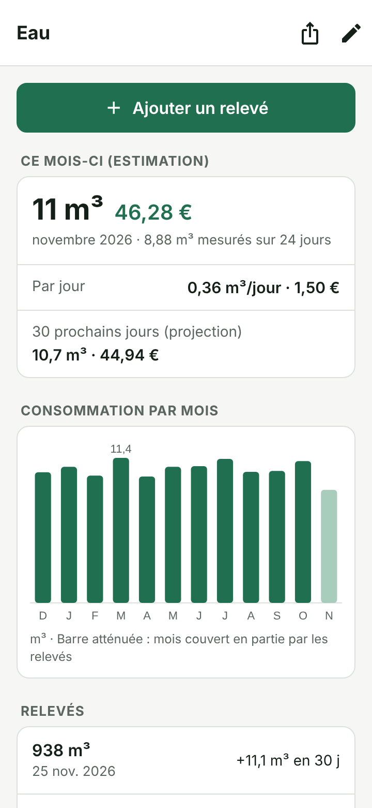
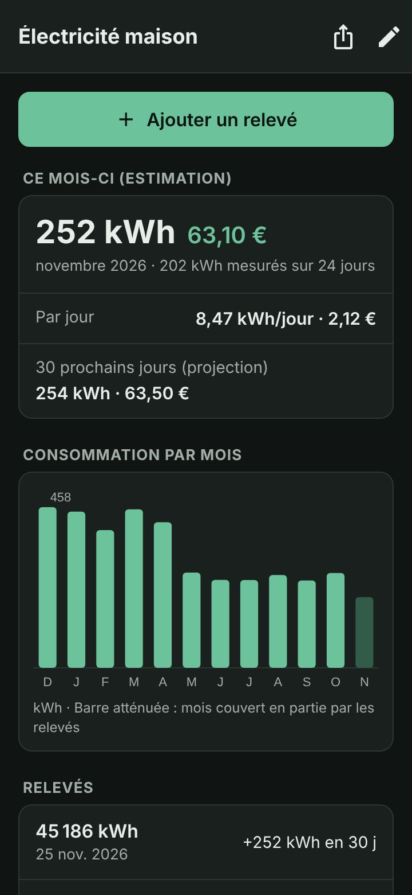

# Relevés (Meter Log)

Notez les relevés de vos compteurs (électricité, eau, gaz ou tout autre compteur) et voyez combien vous consommez.
App Android, hors ligne, open source. Français et anglais.

[English version](README.md)

| Compteur (eau) | Compteur (mode sombre) |
| --- | --- |
|  |  |

*Aperçu web avec des données d’exemple, 360 px de large. Les captures Android sont produites par l’émulateur de la CI (artefact `screenshots`).*

## Fonctionnalités

- Plusieurs compteurs : électricité (kWh), eau (m³), gaz (m³) ou unité libre, avec un prix par unité facultatif.
- Ajout d’un relevé (date + index). Un index plus bas que le relevé précédent est refusé, sauf si vous cochez
  « Compteur remplacé ou remis à zéro », qui commence une nouvelle série.
- Pour chaque compteur : relevés avec la consommation depuis le précédent, moyenne par jour, estimation du
  mois en cours, projection sur 30 jours, coût si un prix est indiqué.
- Graphique en barres des 12 derniers mois. La consommation entre deux relevés est répartie sur les jours :
  les mois sont coupés à leurs vraies limites ; un mois couvert en partie par les relevés est atténué.
- Rappel mensuel facultatif (notification locale). L’autorisation n’est demandée qu’à l’activation.
- Export CSV des relevés d’un compteur via le menu de partage.
- Thème clair et sombre, nombres et dates au format du téléphone.

## Confidentialité

Aucune donnée ne quitte le téléphone. Sans compte, sans publicité, sans statistiques, sans accès réseau
(la permission Android `INTERNET` est retirée). Les relevés sont stockés dans une base SQLite locale.
Voir [PRIVACY.md](PRIVACY.md).

## Compiler

Prérequis : Node 22 et, pour un APK, le JDK 17 et le SDK Android.

```sh
npm ci
npm run typecheck && npm run lint && npm test
npx expo prebuild --platform android
cd android && ./gradlew assembleRelease
```

L’APK de `android/app/build/outputs/apk/release/` est signé avec la clé de debug du modèle : bon pour tester,
pas pour le Play Store. Le workflow GitHub Actions (`.github/workflows/android.yml`) lance les vérifications,
compile l’APK, prend des captures sur un émulateur et joint l’APK à une release pour les tags `v*`.

`npm run web` lance un aperçu web avec des données d’exemple gardées en mémoire (rien n’est enregistré).

iOS n’est pas testé.

## Licence

[MIT](LICENSE) © 2026 Firas Hmedi
