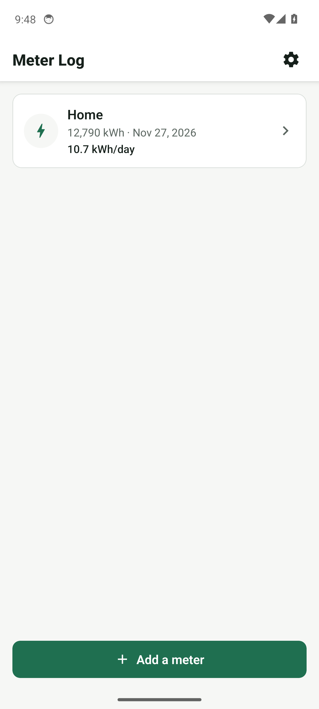
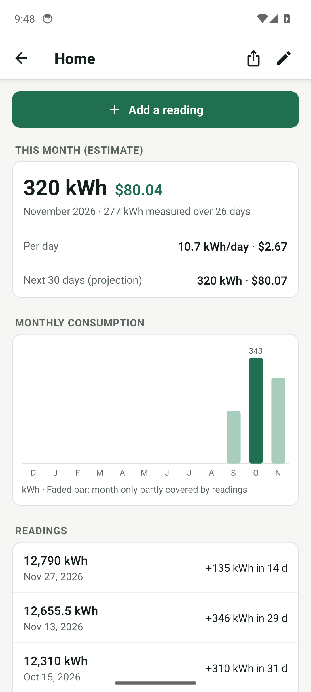
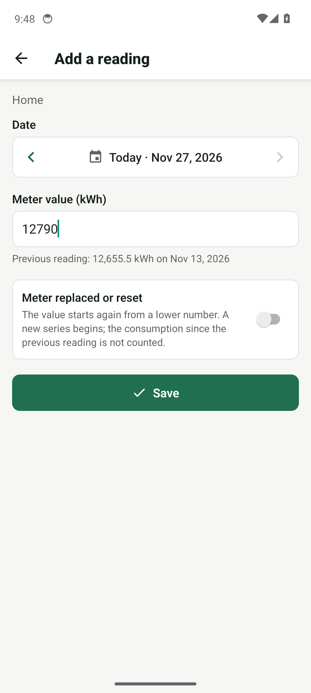
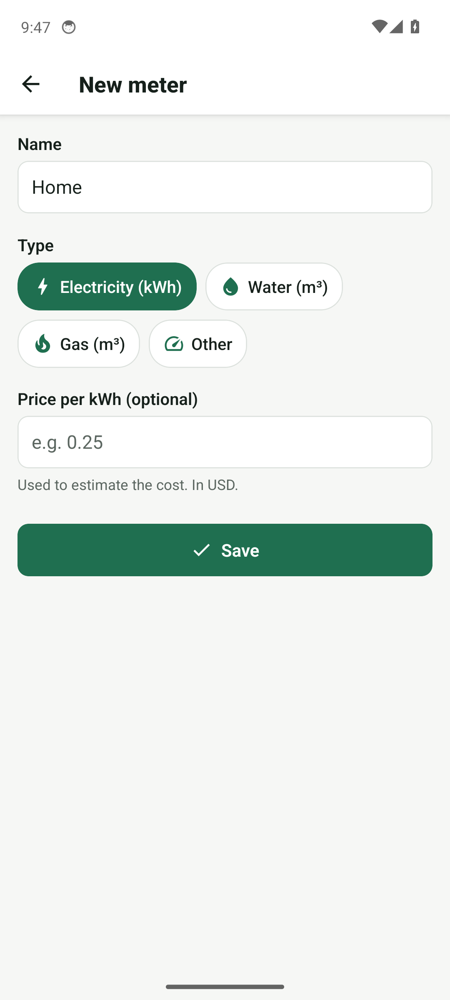
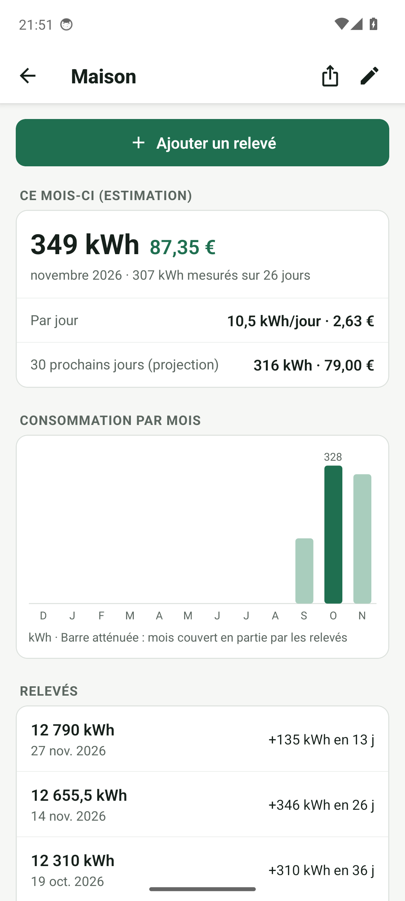
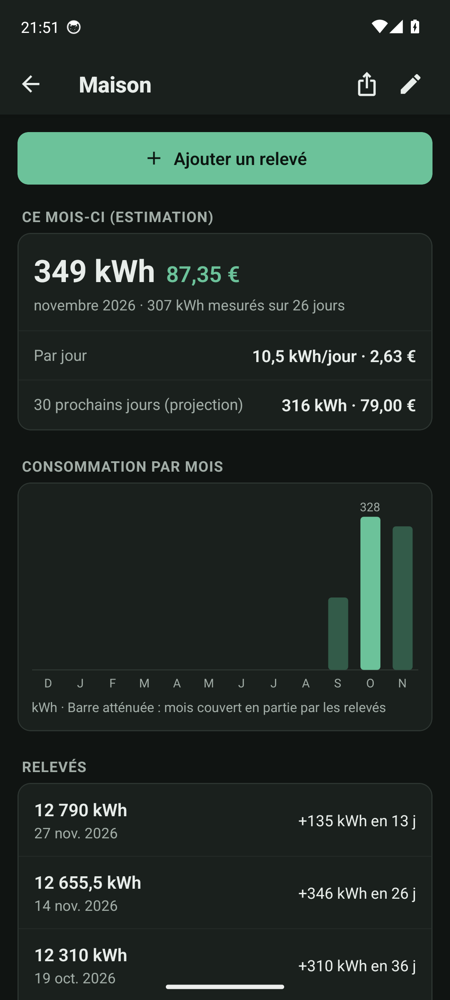
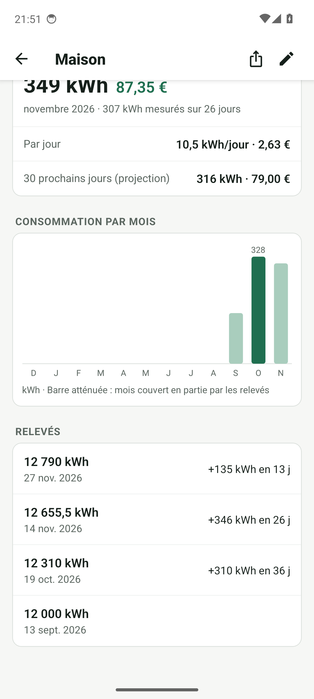
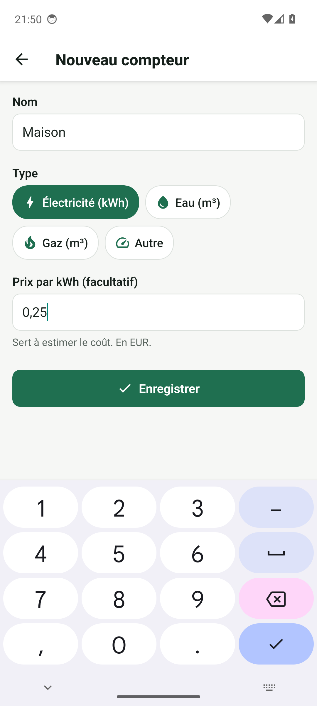

# Meter Log (Relevés)

Log your home meter readings (electricity, water, gas or any other meter) and see how much you consume.
Android app, offline, open source. French and English.

[Version française](README.fr.md)

| Meters | Meter | New reading | New meter |
| --- | --- | --- | --- |
|  |  |  |  |

| French | French, dark mode | Readings (French) | Keyboard open (French) |
| --- | --- | --- | --- |
|  |  |  |  |

*Screenshots from the Android emulator of the CI (API 34, 1080×2400), with sample data typed through the app.*

## Features

- Several meters: electricity (kWh), water (m³), gas (m³) or a custom unit, with an optional price per unit.
- Add a reading (date + value). A value lower than the previous reading is refused, unless you tick
  "Meter replaced or reset", which starts a new series.
- Per meter: readings with the consumption since the previous one, average per day, estimate for the
  current month, projection for the next 30 days, cost when a price is set.
- Bar chart of the last 12 months. Consumption between two readings is spread evenly over the days, so
  months are cut at their real boundaries; months only partly covered by readings are shown faded.
- Optional monthly reminder (local notification). The notification permission is asked only when you turn it on.
- CSV export of a meter's readings through the share sheet.
- Home-screen widget "Log a reading": last reading and days since, for up to 2 meters (the ones that need a
  reading most). Tap a meter to open its new-reading form. Light and dark, French and English.
- Light and dark theme, numbers and dates in the phone's format.

## Privacy

No data leaves the phone. No account, no ads, no analytics, no network access (the Android `INTERNET`
permission is removed). Readings are stored in a local SQLite database. See [PRIVACY.md](PRIVACY.md).

## Build locally

Requirements: Node 22, and for an APK, JDK 17 and the Android SDK.

```sh
npm ci
npm run typecheck && npm run lint && npm test
npx expo prebuild --platform android
cd android && ./gradlew assembleRelease
```

The APK in `android/app/build/outputs/apk/release/` is signed with the debug key of the template:
fine for testing, not for the Play Store. The GitHub Actions workflow (`.github/workflows/android.yml`)
runs the checks, builds the APK, takes emulator screenshots in English and French and attaches the APK to a release on `v*` tags.

`npm run web` starts a web preview that uses sample data kept in memory (nothing is saved). Its older
screenshots are in `docs/screenshots/web/`.

Stack: Expo SDK 58, React Native, TypeScript, Expo Router, expo-sqlite, expo-notifications,
react-native-svg. Calculations live in `src/lib/` and are covered by Jest tests.

iOS is not tested.

## License

[MIT](LICENSE) © 2026 Firas Hmedi
